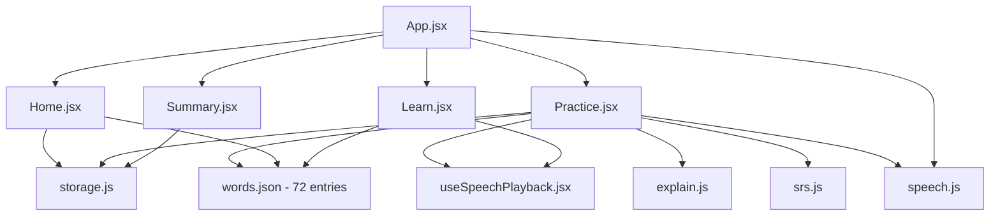

# MedGerman — Full App Walkthrough

> **Live at:** [http://localhost:5173](http://localhost:5173) | **Dev mode:** [http://localhost:5173/?dev=1](http://localhost:5173/?dev=1)
>
> Open it in your browser to follow along. Use Chrome for best audio support.

---

## Architecture at a Glance



---

## The 4-Tab Shell (current UI)

**Files:** [App.jsx](file:///c:/Users/ABCOM/Desktop/MedGerman/src/App.jsx), [Hub.jsx](file:///c:/Users/ABCOM/Desktop/MedGerman/src/components/Hub.jsx), [SideNav.jsx](file:///c:/Users/ABCOM/Desktop/MedGerman/src/components/SideNav.jsx), [LaunchOverlay.jsx](file:///c:/Users/ABCOM/Desktop/MedGerman/src/components/LaunchOverlay.jsx)

The app opens with a **launch animation** ("Willkommen", once per browser session via `sessionStorage`, tap to skip), then lands on a **hub of 4 glass cards** under a **fixed header**:

| Header element | Behaviour |
|---|---|
| Hamburger (left) | Side nav: Settings (sound mute + default playback speed), Export/Import progress, Word mastery overview, Word browser (Learn), About placeholder |
| Center | App name, or the display name once set (tap → hub) |
| Avatar + "Lvl N" (right) | Tap → Tab 1 |

| Tab | File | What it does |
|---|---|---|
| 1 · Profile | [ProfileTab.jsx](file:///c:/Users/ABCOM/Desktop/MedGerman/src/components/ProfileTab.jsx) | Read-only stats: XP, level, streak, sessions completed, overall accuracy bar, test-score history, star history. Display name set/edited here |
| 2 · Daily Challenge | [DailyTab.jsx](file:///c:/Users/ABCOM/Desktop/MedGerman/src/components/DailyTab.jsx) | 3–5 due words (or recent-session fallback) via [quiz.js](file:///c:/Users/ABCOM/Desktop/MedGerman/src/lib/quiz.js). Quiz mode: no explanations, no re-queue. Stars: 5/5=3, 3–4=2, 1–2=1, 0=0, logged per day |
| 3 · Current Level | [LevelTab.jsx](file:///c:/Users/ABCOM/Desktop/MedGerman/src/components/LevelTab.jsx) | 9 levels from [levels.json](file:///c:/Users/ABCOM/Desktop/MedGerman/src/data/levels.json) (7 content + 2 stretch stubs "Coming soon"). Completion = word answered correctly once, stored **separately** from SRS boxes (`medgerman-level-completion`). Practice here uses the full loop |
| 4 · Take a Test | [TestTab.jsx](file:///c:/Users/ABCOM/Desktop/MedGerman/src/components/TestTab.jsx) | Timed cumulative test (3:30 at Lvl 1, less at higher levels — see `test` config in levels.json). Score + date logged to Tab 1 |

The classic dashboard lives on as **Word mastery overview** (side nav), and the full Learning Path remains reachable from the side nav and Tab 3. Storage additions in [storage.js](file:///c:/Users/ABCOM/Desktop/MedGerman/src/lib/storage.js): `medgerman-profile` (name + default rate), `-level-completion`, `-daily-stars`, `-test-scores`, `-sessions` — all included in Export/Import.

---

## Screen 1: Home Dashboard (Day 0 - First Visit)

**File:** [Home.jsx](file:///c:/Users/ABCOM/Desktop/MedGerman/src/components/Home.jsx)

When you open the app for the first time (no localStorage data), you see:

```
+-----------------------------+
|  MedGerman      [Sound on]  |  <- text mute toggle (no emoji)
+-----------------------------+
|  0 day streak | Lvl 1  0 XP |
|  A1 Einsteiger . 0/200 XP   |
+-----------------------------+
|  Today's goal               |
|  (ring)  0 / 30 XP          |  <- fills as you earn XP today
+-----------------------------+
|  Start with 5 words.        |
|  It takes about 3 minutes.  |
|  [ Start Practice ]         |
|  [ Learn New Words 40 new ] |
+-----------------------------+
|  0 / 72 words mastered     |
|  (Mastered/Familiar/       |
|   Learning/New stacked bar)|
+-----------------------------+
|  DEV MODE (only ?dev=1)     |
+-----------------------------+
```

**What happens:**
- `seenCount` counts words in localStorage. If 0, the Day-0 card appears.
- Stats bar shows day streak and level (XP-based, see [calculateLevel in storage.js](file:///c:/Users/ABCOM/Desktop/MedGerman/src/lib/storage.js)).
- Daily goal ring ([loadDailyXP, DAILY_XP_GOAL = 30 XP](file:///c:/Users/ABCOM/Desktop/MedGerman/src/lib/storage.js)) fills as you earn XP today; resets at midnight.
- Mastery overview: single stacked bar (Mastered / Familiar / Learning / New) with a legend.

---

## Screen 2: Learn New Words

**File:** [Learn.jsx](file:///c:/Users/ABCOM/Desktop/MedGerman/src/components/Learn.jsx)

Clicking **"Learn New Words"** shows the learning path with all 72 entries. Two view modes: **Path** (default) and **Cards**.

```
+-----------------------------+
| <- Home   Learning Path     |
|           [ Path | Cards ]  |
+-----------------------------+
|  [Aa] Letters & Sounds  v   |  <- collapsible alphabet grid
|                             |     (tap a letter tile to hear it)
+-----------------------------+
|  [Lvl] Body & Anatomy       |  <- checkpoint node per theme
|     o der Kopf              |  <- winding path of word nodes
|       o der Arm             |     (check = mastered, B2 = box 2,
|     o das Auge              |      dash = not seen yet)
+-----------------------------+
|  [Lvl] Symptoms & Vitals    |
|  ...                        |
+-----------------------------+
|  [Lvl] Stretch Goals (B1)   |  <- unlocks at 60% A1 familiarity
|  (Locked)                   |
+-----------------------------+
|  [ Start Practice -> ]      |  <- floating CTA
+-----------------------------+
```

**What happens:**
- Words are grouped by `theme` (B1-level words go into the virtual `b1_stretch` theme) from [words.json](file:///c:/Users/ABCOM/Desktop/MedGerman/src/data/words.json).
- Six groups: `body` (17), `symptoms` (14), `patient_care` (14), `hospital_places` (5), `sentences` (22), plus `b1_stretch` (B1 words).
- Tapping a word node opens the **word modal**: German word with audio, English, note, example + tip, and a "Practice This Word" button that starts a session focused on that word.
- Tapping a checkpoint opens **theme stats**: mastered / in progress / new / average Leitner box, with "Practice <theme>".
- Audio buttons are plain text: **0.5x** (half speed) and **Listen**. While a word plays, its letters highlight one by one, synced to the speech via boundary events (timed fallback otherwise) - see [useSpeechPlayback.jsx](file:///c:/Users/ABCOM/Desktop/MedGerman/src/lib/useSpeechPlayback.jsx).
- If no German voice is detected, audio buttons are disabled + a banner shows at top.

---

## Screen 3: Practice Session - 6 Exercise Types

**File:** [Practice.jsx](file:///c:/Users/ABCOM/Desktop/MedGerman/src/components/Practice.jsx)

The session builder ([session.js](file:///c:/Users/ABCOM/Desktop/MedGerman/src/lib/session.js)) picks up to 5 new words + all due words, and selects exercise types based on Leitner box. The queue is capped at 15 graded exercises per session; wrong answers are re-queued at the end.

### Session progress bar

Every practice screen shows `3 / 15 · Attempt 2` plus a **Restart** button (top right) that replays the session from the beginning. "Attempt" counts how many times you've seen the current exercise in this session (re-queued wrong answers raise it).

### Exercise Type Selection

| Box | Exercise Type | Description |
|-----|--------------|-------------|
| 0-1 | **mcq** | Show German word, pick English meaning (4 options) |
| 0-1 | **article** | Show `___ Kopf`, pick `der` / `die` / `das` |
| 2-3 | **listening** | Hear audio, pick English meaning (4 options) |
| 2-3 | **cloze** | Fill the blank in a sentence (4 German word options) |
| 4-5 | **typing** | Given English, type the German word |
| 4-5 | **sentence** | Given English sentence, type full German sentence |

### 3a. Multiple Choice (MCQ) - Boxes 0-1

```
  What does this mean?
  der Kopf               [0.5x Listen]

  [ head          ]     <- correct
  [ leg           ]
  [ stomach       ]
  [ arm           ]
```

### 3b. Article Picking - Boxes 0-1

```
  Pick the correct article
  ___ Bein               [0.5x Listen]

  [ der ]  [ die ]  [ das ]
```

### 3c. Listening - Boxes 2-3

```
  Listen and pick the meaning

      [ 0.5x | Play ]    <- plays the German word

  [ pain          ]
  [ fever         ]
  [ cough         ]
  [ nausea        ]
```

### 3d. Cloze (Fill in the Blank) - Boxes 2-3

```
  Fill in the blank
  Mein ______ tut weh.   [0.5x Listen]

  [ Kopf    ]            <- correct
  [ Bauch   ]
  [ Ruecken ]
  [ Arm     ]
```

### 3e. Typing - Boxes 4-5

```
  Type the German word
  head                    [0.5x Listen]

  [________________________]
  [ Check ]
  Tip: you can type ae, oe, ue, ss instead of ae, oe, ue, ss
```

### 3f. Sentence Typing - Boxes 4-5

```
  Type this sentence in German
  I will measure your blood pressure now.   [0.5x Listen]

  [________________________]
  [ Check ]
  Tip: you can type ae, oe, ue, ss instead of ae, oe, ue, ss
```

### 3-0. New-Word Intro: Full-Screen Pronunciation Check (NEW)

Before a brand-new word appears in the session, a **full-screen overlay** takes over the whole viewport. Only the word is shown, centered, in large type:

```
+----------------------------------+
| NEW WORD             Attempt 1   |
|                                  |
|                                  |
|         d  a  s   A  u  g  e     |  <- letters highlight one by one
|         (yellow)                 |     while the word is spoken
|                                  |
|   Listen, then say the word aloud|
|                                  |
|  [0.5x] [Listen] [Say it]        |
|              [Skip ->]           |
+----------------------------------+
```

**How it works:**
1. The word is spoken automatically on entry (0.8x rate), with **letter-by-letter highlighting** timed to the audio.
2. Tap **Say it**: the microphone opens (Web Speech `de-DE`).
   - Recognised speech matches the word (umlaut-tolerant matching, [isPronunciationMatch](file:///c:/Users/ABCOM/Desktop/MedGerman/src/lib/speech.js)) -> the **whole screen turns green**, a success sound plays, and it advances automatically after ~1.6s.
   - No match -> the **screen turns red**, the word replays at 0.5x, and the attempt counter increments.
3. If the device has no microphone/recognizer, a **self-check fallback** appears: "I said it correctly" / "Not correct yet" buttons produce the same green/red screens.
4. **Skip** moves on without grading (the intro never counts toward the score).

---

## Screen 4: Feedback - Correct Answer

After answering correctly:

```
  Correct!                     <- green background

  info: Nouns start with a     <- soft note (only if lenient
     capital letter: Kopf         match was used)

  der Kopf - head
  Mein Kopf tut weh.
  My head hurts.

  [ Next -> ]
```

**Lenient typing** ([explain.js lines 34-94](file:///c:/Users/ABCOM/Desktop/MedGerman/src/lib/explain.js#L34-L94)):
- `kopf` -> accepted, note: "Nouns start with a capital letter: Kopf"
- `Fuss` -> accepted, note: "Correct spelling: Fuss (you can type ss, that is fine)"
- `Ruecken` -> accepted, note: "Correct spelling: Ruecken (you can type ue, that is fine)"

---

## Screen 5: Feedback - Wrong Answer + Explain Mistake

After answering incorrectly:

```
  Incorrect                    <- red background

  You answered: die
  Correct:      das

  You'll see this word again
  in this session, and again
  in 1 minute.                 <- or "tomorrow" in non-dev

  das Bein - leg
  Das Bein ist geschwollen.
  The leg is swollen.

  [ Explain Mistake ]          <- click to expand

  [ Next -> ]
```

### After clicking "Explain Mistake"

Explanation comes from the **AI tutor endpoint** (`/api/explain`) when configured — under strict anti-hallucination constraints, validated client-side. Otherwise it falls back to the deterministic engine [buildExplanation()](file:///c:/Users/ABCOM/Desktop/MedGerman/src/lib/explain.js#L215-L344) - offline, no AI, no network. Identical mistakes are served from a local cache without spending API quota:

**Article mistake:**
```
Explanation:
  You chose: die
  Correct: das Bein (leg)
  Every German noun has a fixed article.
  You can't guess it, so learn 'das Bein' as one unit.
  Remember: Rhymes with line - stand on two legs: das Bein.
```

**MCQ mistake** (chose "fever" instead of "pain"):
```
Explanation:
  You chose: fever = das Fieber
  Correct: der Schmerz = pain
  Fieber means fever. Schmerz means pain.
  Remember: Think of a smarting pain: der Schmerz.
```

**Audio/Listening mistake:**
```
Explanation:
  You heard: das Medikament
  You chose: tablet
  Correct: medication
  Remember: Same as English 'medication'. Only learn the article: das.
```

**Cloze mistake:**
```
Explanation:
  You chose: Mund (mouth)
  Sentence: "Mein Kopf tut weh." = "My head hurts."
  The English says head, so the missing word is Kopf.
  Remember: Think of a cap on your head: der Kopf.
```

**Typing mistake** (typed "kopf"):
```
Explanation:
  You typed: kopf
  Correct: Kopf
  All German nouns must start with a capital letter.
  Remember: Think of a cap on your head: der Kopf.
```

**Sentence mistake** (word order):
```
Explanation:
  You wrote: Ich messe Ihren jetzt Blutdruck.
  Correct: Ich messe jetzt Ihren Blutdruck.
  Word order differs: 'Ihren' is misplaced.
  Remember: Messen means to measure.
```

### Hint Logic

The "Remember:" hint in the deterministic fallback is rule-based - never AI-generated:

| Condition | Hint |
|-----------|------|
| Word has a `tip` in words.json | `Remember: <tip>` |
| Word has `cognate: true` | `Remember: Same as English '<english>'. Only learn the article: <article>.` |
| Sentence exercise | `Remember: read it aloud slowly, word by word.` |
| Fallback | `Remember: <article> <german> = <english>.` |

---

## Screen 6: Wrong-Answer Re-queuing

When you get a word wrong:
1. It is immediately **re-added to the end** of the current session queue ([Practice.jsx line 99](file:///c:/Users/ABCOM/Desktop/MedGerman/src/components/Practice.jsx#L98-L100)).
2. The SRS box is **demoted to 0** and due immediately ([srs.js lines 37-43](file:///c:/Users/ABCOM/Desktop/MedGerman/src/lib/srs.js#L36-L43)).
3. You see a message: "You'll see this word again in this session, and again tomorrow."

This creates the **revisit loop**: Learn -> Mistake -> See again -> Get it right.

---

## Screen 7: Session Summary

**File:** [Summary.jsx](file:///c:/Users/ABCOM/Desktop/MedGerman/src/components/Summary.jsx)

After the last exercise:

```
  Keep going!                  <- milestone line above (e.g. "2 words away from 5 mastered!")

          80%                  <- big percentage
       4 / 5 correct

  Session bonus        +5 XP   <- once per completed session
  Total XP             110
  Level 1      A1 Einsteiger

  Next review: 5 words
  in 1 minute (dev)            <- or "tomorrow" normally

  Words to review
  +---------------------+
  | das Bein   [Listen] |     <- text button, no emoji
  | leg                 |
  +---------------------+

  [ Practise Again ]           <- fresh session
  [ Redo This Session ]        <- replays the exact same exercises
  [ Back to Home ]
```

If you got everything right: "Perfect session - no mistakes!" A celebration of colored dots (no emoji) falls from the top.

The "Next review" text is computed by [getSummaryNextReview()](file:///c:/Users/ABCOM/Desktop/MedGerman/src/components/Summary.jsx#L82-L134), milestone line by [computeMilestone](file:///c:/Users/ABCOM/Desktop/MedGerman/src/lib/milestone.js).

---

## Screen 8: Home Dashboard (Returning Learner)

After your first session, the Home screen transforms:

```
  1 day streak | Lvl 1 110 XP
  A1 Einsteiger . 110/200 XP

  Today's goal
  (ring) 50 / 30 XP  <- filled if goal reached

  +=======================+
  | 5 words due for review |   <- or "Next review: 5 words
  |  [ Review Now ]        |      in 1 minute (dev)"
  +=======================+

  [ Learn New Words 35 new ]   <- 72 - 37 = 35 unseen
  [ Practise Anyway ]          <- appears when words are due

  -- Mastery overview ------
  0 / 72 words mastered
  [Mastered|Familiar|Learning|New]

  -- Words Needing Practice --
  der Arm      1 wrong / 2 seen

  DEV MODE (only ?dev=1)
  [ Reset progress ]
```

**What happens:**
- **Due card**: Shows "X words due" + "Review Now", or next review countdown + "Practise Anyway".
- **Mastery bar**: Single stacked bar of Mastered / Familiar / Learning / New counts.
- **Weakest words**: Top 5 by `wrong / seen` ratio.
- **Streak**: Increments daily, resets if you skip a day.
- **Streak warning**: If the streak would expire within 12h, a banner shows "Your streak ends in Xh - practice now!"

---

## Spaced Repetition System (SRS)

**File:** [srs.js](file:///c:/Users/ABCOM/Desktop/MedGerman/src/lib/srs.js)

| Box | Normal Interval | Dev Interval |
|-----|----------------|--------------|
| 0 | Immediate (0 days) | Immediate (0 min) |
| 1 | 1 day | 1 min |
| 2 | 2 days | 2 min |
| 3 | 4 days | 3 min |
| 4 | 8 days | 5 min |
| 5 | 16 days | 8 min |

- **Correct** -> promote to next box, set due date based on new box interval.
- **Wrong** -> demote to box 0, due immediately, increment `wrong` counter.

---

## Data: 72 Words and Sentences

**File:** [words.json](file:///c:/Users/ABCOM/Desktop/MedGerman/src/data/words.json)

| # | Theme | Count | Levels | Examples |
|---|-------|-------|--------|----------|
| 1 | `body` | 17 | A1/A2 | der Kopf, der Arm, das Auge, der Mund, das Ohr, die Lunge |
| 2 | `symptoms` | 14 | A1/A2 | der Schmerz, das Fieber, der Husten, Kopfschmerzen (Pl.) |
| 3 | `patient_care` | 14 | A1/A2 | die Tablette, die Spritze, das Medikament, das Rezept |
| 4 | `hospital_places` | 5 | A1 | die Station, das Labor, der Notfallraum |
| 5 | `sentences` | 22 | A1/A2/B1 | "Ich messe jetzt Ihren Blutdruck." |

Levels: 50 A1, 15 A2, 7 B1 (B1 words live in the locked "Stretch Goals" theme until 60% A1 familiarity is reached).

Each word entry has:
- `de` / `en` - German and English
- `article` - der/die/das (null for sentences)
- `example` / `exampleEn` - contextual sentence
- `tip` - curated memory hint (no AI)
- `cognate` - true if near-identical to English (Arm, Hand, Fieber, etc.)
- `plural` - true for Kopfschmerzen

---

## Audio System

**File:** [speech.js](file:///c:/Users/ABCOM/Desktop/MedGerman/src/lib/speech.js) + [useSpeechPlayback.jsx](file:///c:/Users/ABCOM/Desktop/MedGerman/src/lib/useSpeechPlayback.jsx)

- Uses Web Speech API with `de-DE` locale. Normal playback 0.8-0.85x; every screen offers a **0.5x** half-speed button.
- **Letter-by-letter highlighting**: while a word plays, the character being spoken is highlighted (yellow). When the browser fires `onboundary` events (Chrome desktop, most Android voices), highlighting is exactly synced to the audio; otherwise a timed emulation paced by speech rate takes over.
- On load, checks if any German voice is installed; listens for `voiceschanged` (voices load async on mobile).
- If no German voice: shows dismissible banner, disables all audio buttons, replaces listening exercises with cloze/typing.
- **Pronunciation check** (new-word intro): Web Speech Recognition `de-DE` with umlaut-tolerant comparison; falls back to self-confirm buttons when no recognizer/mic exists.

---

## Dev Mode (?dev=1)

Add `?dev=1` to the URL to enable:
1. **Minute-based intervals** instead of days (test the full SRS cycle in about 15 minutes).
2. **Reset progress** button to clear localStorage and start fresh.
3. Next-review labels show "(dev)" suffix.

---

## File Map

| File | Purpose | Lines |
|------|---------|-------|
| [index.html](file:///c:/Users/ABCOM/Desktop/MedGerman/index.html) | Entry point, PWA manifest + theme links | ~30 |
| [App.jsx](file:///c:/Users/ABCOM/Desktop/MedGerman/src/App.jsx) | 4-tab shell router, fixed header + side nav, timed quiz runner | ~380 |
| [Hub.jsx](file:///c:/Users/ABCOM/Desktop/MedGerman/src/components/Hub.jsx) | Hub screen: 4 glass cards with live badges | ~110 |
| [ProfileTab.jsx](file:///c:/Users/ABCOM/Desktop/MedGerman/src/components/ProfileTab.jsx) | Tab 1: stats, accuracy, histories, display name | ~230 |
| [DailyTab.jsx](file:///c:/Users/ABCOM/Desktop/MedGerman/src/components/DailyTab.jsx) | Tab 2: daily challenge intro + star history | ~110 |
| [LevelTab.jsx](file:///c:/Users/ABCOM/Desktop/MedGerman/src/components/LevelTab.jsx) | Tab 3: level path, X/N completion, stretch stubs | ~160 |
| [TestTab.jsx](file:///c:/Users/ABCOM/Desktop/MedGerman/src/components/TestTab.jsx) | Tab 4: timed test intro from levels.json timing | ~90 |
| [SideNav.jsx](file:///c:/Users/ABCOM/Desktop/MedGerman/src/components/SideNav.jsx) | Settings, Export/Import, mastery + Learn links, About | ~210 |
| [LaunchOverlay.jsx](file:///c:/Users/ABCOM/Desktop/MedGerman/src/components/LaunchOverlay.jsx) | "Willkommen" launch animation (sessionStorage) | ~70 |
| [levels.js](file:///c:/Users/ABCOM/Desktop/MedGerman/src/lib/levels.js) | levels.json accessors: progress, unlocks, test timing | ~140 |
| [quiz.js](file:///c:/Users/ABCOM/Desktop/MedGerman/src/lib/quiz.js) | Daily + test queue builders (reuses session engine) | ~100 |
| [levels.json](file:///c:/Users/ABCOM/Desktop/MedGerman/src/data/levels.json) | Level tiers (7 content + 2 stretch stubs) + test timing | ~90 |
| [Home.jsx](file:///c:/Users/ABCOM/Desktop/MedGerman/src/components/Home.jsx) | Dashboard: streak, level, daily goal ring, mastery bar, weakest words | ~300 |
| [Learn.jsx](file:///c:/Users/ABCOM/Desktop/MedGerman/src/components/Learn.jsx) | Learning path + cards view, alphabet, word/theme modals | ~520 |
| [Practice.jsx](file:///c:/Users/ABCOM/Desktop/MedGerman/src/components/Practice.jsx) | Full-screen intro, exercise renderer, feedback, restart, attempts | ~900 |
| [Summary.jsx](file:///c:/Users/ABCOM/Desktop/MedGerman/src/components/Summary.jsx) | Session results, XP, Redo This Session | ~190 |
| [srs.js](file:///c:/Users/ABCOM/Desktop/MedGerman/src/lib/srs.js) | Leitner boxes, grading, per-type stats, B1 unlock | ~160 |
| [session.js](file:///c:/Users/ABCOM/Desktop/MedGerman/src/lib/session.js) | Session builder: pick words + exercise types, 15-cap, adaptive | ~250 |
| [explain.js](file:///c:/Users/ABCOM/Desktop/MedGerman/src/lib/explain.js) | Deterministic explanations, AI tutor with cache, lenient typing | ~440 |
| [speech.js](file:///c:/Users/ABCOM/Desktop/MedGerman/src/lib/speech.js) | Web Speech wrapper, boundary events, pronunciation matching | ~330 |
| [useSpeechPlayback.jsx](file:///c:/Users/ABCOM/Desktop/MedGerman/src/lib/useSpeechPlayback.jsx) | React hook: letter-by-letter highlight state + renderer | ~160 |
| [sound.js](file:///c:/Users/ABCOM/Desktop/MedGerman/src/lib/sound.js) | Correct/incorrect sound effects, mute toggle | ~80 |
| [storage.js](file:///c:/Users/ABCOM/Desktop/MedGerman/src/lib/storage.js) | localStorage: progress, streak, XP, daily goal, levels | ~200 |
| [milestone.js](file:///c:/Users/ABCOM/Desktop/MedGerman/src/lib/milestone.js) | Milestone + next-review texts | ~140 |
| [words.json](file:///c:/Users/ABCOM/Desktop/MedGerman/src/data/words.json) | 72 vocabulary entries with tips and cognate flags | ~700 |
| [index.css](file:///c:/Users/ABCOM/Desktop/MedGerman/src/index.css) | Full app styling, phone-first, glass shell surfaces | ~2900 |
| test/*.test.js | 6 suites: explain, srs, session, storage, milestone, speech | ~600 |
