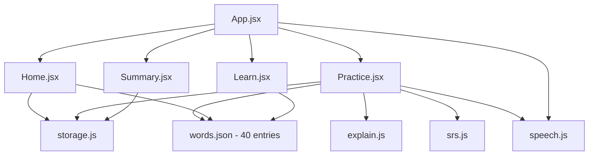

# MedGerman — Full App Walkthrough

> **Live at:** [http://localhost:5173](http://localhost:5173) | **Dev mode:** [http://localhost:5173/?dev=1](http://localhost:5173/?dev=1)
>
> Open it in your browser to follow along. Use Chrome for best audio support.

---

## Architecture at a Glance



---

## Screen 1: Home Dashboard (Day 0 - First Visit)

**File:** [Home.jsx](file:///c:/Users/ABCOM/Desktop/MedGerman/src/components/Home.jsx)

When you open the app for the first time (no localStorage data), you see:

```
+-----------------------------+
|  MedGerman                  |  <- blue header bar
+-----------------------------+
|  fire 0 day streak          |
|                             |
|  +=======================+  |
|  | Start with 5 words.   |  |
|  | It takes ~3 minutes.  |  |
|  |                       |  |
|  |  [ Start Practice ]   |  |  <- primary blue button
|  +=======================+  |
|                             |
|  [ Learn New Words 40 new ] |  <- secondary button w/ badge
|                             |
|  DEV MODE: intervals in     |  <- only with ?dev=1
|     minutes [0,1,2,3,5,8]  |
|  [ Reset progress ]         |
+-----------------------------+
```

**What happens:**
- [Line 60-61](file:///c:/Users/ABCOM/Desktop/MedGerman/src/components/Home.jsx#L60-L61): `seenCount` counts words in localStorage. If 0, the Day-0 card appears.
- [Line 88-98](file:///c:/Users/ABCOM/Desktop/MedGerman/src/components/Home.jsx#L88-L98): Renders the Day-0 welcome with "Start Practice" and "Learn New Words (40 new)" buttons.
- Streak is always shown at the top ([line 81-85](file:///c:/Users/ABCOM/Desktop/MedGerman/src/components/Home.jsx#L81-L85)).

---

## Screen 2: Learn New Words

**File:** [Learn.jsx](file:///c:/Users/ABCOM/Desktop/MedGerman/src/components/Learn.jsx)

Clicking **"Learn New Words"** shows all 40 entries grouped by theme:

```
+-----------------------------+
|  Learn New Words            |
|                             |
|  -- Body ----------------  |
|  +---------------------+   |
|  | der Kopf         sp  |   |  <- speaker button (plays audio)
|  | head                 |   |
|  | Mein Kopf tut weh.  |   |  <- example sentence
|  | My head hurts.      |   |
|  +---------------------+   |
|  +---------------------+   |
|  | der Arm           sp |   |
|  | arm                  |   |
|  +---------------------+   |
|  ... (12 body words)        |
|                             |
|  -- Symptoms -----------   |
|  +---------------------+   |
|  | die (Pl.)            |   |  <- plural badge
|  | Kopfschmerzen     sp |   |
|  | headache             |   |
|  +---------------------+   |
|  ... (10 symptom words)     |
|                             |
|  -- Patient Care -------   |
|  ... (10 patient care)      |
|                             |
|  -- Sentences (A2) ----    |
|  ... (8 clinical sentences) |
|                             |
|  [ Start Practice -> ]      |
+-----------------------------+
```

**What happens:**
- [Lines 20-24](file:///c:/Users/ABCOM/Desktop/MedGerman/src/components/Learn.jsx#L20-L24): Groups all 40 words by `theme` from [words.json](file:///c:/Users/ABCOM/Desktop/MedGerman/src/data/words.json).
- Four groups: `body` (12), `symptoms` (10), `patient_care` (10), `sentences` (8).
- Speaker buttons call [speak()](file:///c:/Users/ABCOM/Desktop/MedGerman/src/lib/speech.js#L83-L108) - German audio via Web Speech API at 0.85x speed.
- If no German voice detected, buttons are disabled + a banner shows at top.

---

## Screen 3: Practice Session - 6 Exercise Types

**File:** [Practice.jsx](file:///c:/Users/ABCOM/Desktop/MedGerman/src/components/Practice.jsx)

The session builder ([session.js](file:///c:/Users/ABCOM/Desktop/MedGerman/src/lib/session.js)) picks up to 5 new words + all due words, and selects exercise types based on Leitner box:

### Exercise Type Selection

| Box | Exercise Type | Description |
|-----|--------------|-------------|
| 0-1 | **mcq** | Show German word, pick English meaning (4 options) |
| 0-1 | **article** | Show `___ Kopf`, pick `der` / `die` / `das` |
| 2-3 | **listening** | Hear audio, pick English meaning (4 options) |
| 2-3 | **cloze** | Fill the blank in a sentence (4 German word options) |
| 4-5 | **typing** | Given English, type the German word |
| 4-5 | **sentence** | Given English sentence, type full German sentence |

### 3a. Multiple Choice (MCQ) - Boxes 0-1

```
  What does this mean?
  der Kopf               [speaker]

  [ head          ]     <- correct
  [ leg           ]
  [ stomach       ]
  [ arm           ]
```

### 3b. Article Picking - Boxes 0-1

```
  Pick the correct article
  ___ Bein               [speaker]

  [ der ]  [ die ]  [ das ]
```

### 3c. Listening - Boxes 2-3

```
  Listen and pick the meaning

      [ speaker Play ]    <- plays the German word

  [ pain          ]
  [ fever         ]
  [ cough         ]
  [ nausea        ]
```

### 3d. Cloze (Fill in the Blank) - Boxes 2-3

```
  Fill in the blank
  Mein ______ tut weh.   [speaker]

  [ Kopf    ]            <- correct
  [ Bauch   ]
  [ Ruecken ]
  [ Arm     ]
```

### 3e. Typing - Boxes 4-5

```
  Type the German word
  head                    [speaker]

  [________________________]
  [ Check ]
  Tip: you can type ae, oe, ue, ss instead of ae, oe, ue, ss
```

### 3f. Sentence Typing - Boxes 4-5

```
  Type this sentence in German
  I will measure your blood pressure now.   [speaker]

  [________________________]
  [ Check ]
  Tip: you can type ae, oe, ue, ss instead of ae, oe, ue, ss
```

---

## Screen 4: Feedback - Correct Answer

After answering correctly:

```
  Correct!                     <- green background

  info: Nouns start with a     <- soft note (only if lenient
     capital letter: Kopf         match was used)

  der Kopf - head
  Mein Kopf tut weh.
  My head hurts.

  [ Next -> ]
```

**Lenient typing** ([explain.js lines 34-94](file:///c:/Users/ABCOM/Desktop/MedGerman/src/lib/explain.js#L34-L94)):
- `kopf` -> accepted, note: "Nouns start with a capital letter: Kopf"
- `Fuss` -> accepted, note: "Correct spelling: Fuss (you can type ss, that is fine)"
- `Ruecken` -> accepted, note: "Correct spelling: Ruecken (you can type ue, that is fine)"

---

## Screen 5: Feedback - Wrong Answer + Explain Mistake

After answering incorrectly:

```
  Incorrect                    <- red background

  You answered: die
  Correct:      das

  You'll see this word again
  in this session, and again
  in 1 minute.                 <- or "tomorrow" in non-dev

  das Bein - leg
  Das Bein ist geschwollen.
  The leg is swollen.

  [ Explain Mistake ]          <- click to expand

  [ Next -> ]
```

### After clicking "Explain Mistake"

Built **deterministically** by [buildExplanation()](file:///c:/Users/ABCOM/Desktop/MedGerman/src/lib/explain.js#L215-L344) - no AI, no network:

**Article mistake:**
```
Explanation:
  You chose: die
  Correct: das Bein (leg)
  Every German noun has a fixed article.
  You can't guess it, so learn 'das Bein' as one unit.
  Remember: Rhymes with line - stand on two legs: das Bein.
```

**MCQ mistake** (chose "fever" instead of "pain"):
```
Explanation:
  You chose: fever = das Fieber
  Correct: der Schmerz = pain
  Fieber means fever. Schmerz means pain.
  Remember: Think of a smarting pain: der Schmerz.
```

**Audio/Listening mistake:**
```
Explanation:
  You heard: das Medikament
  You chose: tablet
  Correct: medication
  Remember: Same as English 'medication'. Only learn the article: das.
```

**Cloze mistake:**
```
Explanation:
  You chose: Mund (mouth)
  Sentence: "Mein Kopf tut weh." = "My head hurts."
  The English says head, so the missing word is Kopf.
  Remember: Think of a cap on your head: der Kopf.
```

**Typing mistake** (typed "kopf"):
```
Explanation:
  You typed: kopf
  Correct: Kopf
  All German nouns must start with a capital letter.
  Remember: Think of a cap on your head: der Kopf.
```

**Sentence mistake** (word order):
```
Explanation:
  You wrote: Ich messe Ihren jetzt Blutdruck.
  Correct: Ich messe jetzt Ihren Blutdruck.
  Word order differs: 'Ihren' is misplaced.
  Remember: Messen means to measure.
```

### Hint Logic

The "Remember:" line is **deterministic** - never AI-generated:

| Condition | Hint |
|-----------|------|
| Word has a `tip` in words.json | `Remember: <tip>` |
| Word has `cognate: true` | `Remember: Same as English '<english>'. Only learn the article: <article>.` |
| Sentence exercise | `Remember: read it aloud slowly, word by word.` |
| Fallback | `Remember: <article> <german> = <english>.` |

---

## Screen 6: Wrong-Answer Re-queuing

When you get a word wrong:
1. It is immediately **re-added to the end** of the current session queue ([Practice.jsx line 99](file:///c:/Users/ABCOM/Desktop/MedGerman/src/components/Practice.jsx#L98-L100)).
2. The SRS box is **demoted to 0** and due immediately ([srs.js lines 37-43](file:///c:/Users/ABCOM/Desktop/MedGerman/src/lib/srs.js#L36-L43)).
3. You see a message: "You'll see this word again in this session, and again tomorrow."

This creates the **revisit loop**: Learn -> Mistake -> See again -> Get it right.

---

## Screen 7: Session Summary

**File:** [Summary.jsx](file:///c:/Users/ABCOM/Desktop/MedGerman/src/components/Summary.jsx)

After the last exercise:

```
  Session Complete!

          80%                  <- big percentage
       4 / 5 correct

  Next review: 5 words
  in 1 minute (dev)            <- or "tomorrow" normally

  Words to review
  +---------------------+
  | das Bein          sp |
  | leg                  |
  +---------------------+

  [ Practise Again ]
  [ Back to Home ]
```

If you got everything right: "Perfect session - no mistakes!"

The "Next review" text is computed by [getSummaryNextReview()](file:///c:/Users/ABCOM/Desktop/MedGerman/src/components/Summary.jsx#L82-L134).

---

## Screen 8: Home Dashboard (Returning Learner)

After your first session, the Home screen transforms:

```
  fire 1 day streak

  +=======================+
  | 5 words due for review |   <- or "Next review: 5 words
  |                        |      in 1 minute (dev)"
  |  [ Review Now ]        |   <- if words are due
  +=======================+

  [ Learn New Words 35 new ]   <- 40 - 5 = 35 unseen
  [ Practise Anyway ]          <- appears when words are due

  -- Progress by Box ------
  Box 0  ########          4
  Box 1  ##                1
  Box 2                    0
  Box 3                    0
  Box 4                    0
  Box 5                    0

  -- Weakest Words --------
  das Bein     1 wrong / 2 seen

  DEV MODE
  [ Reset progress ]
```

**What happens:**
- **Due count** ([lines 104-126](file:///c:/Users/ABCOM/Desktop/MedGerman/src/components/Home.jsx#L104-L126)): Shows "X words due" + "Review Now", or next review countdown + "Practise Anyway".
- **Box chart** ([lines 143-162](file:///c:/Users/ABCOM/Desktop/MedGerman/src/components/Home.jsx#L143-L162)): Horizontal bar chart per Leitner box.
- **Weakest words** ([lines 165-181](file:///c:/Users/ABCOM/Desktop/MedGerman/src/components/Home.jsx#L165-L181)): Top 5 by `wrong / seen` ratio.
- **Streak** ([lines 81-85](file:///c:/Users/ABCOM/Desktop/MedGerman/src/components/Home.jsx#L81-L85)): Increments daily, resets if you skip a day.

---

## Spaced Repetition System (SRS)

**File:** [srs.js](file:///c:/Users/ABCOM/Desktop/MedGerman/src/lib/srs.js)

| Box | Normal Interval | Dev Interval |
|-----|----------------|--------------|
| 0 | Immediate (0 days) | Immediate (0 min) |
| 1 | 1 day | 1 min |
| 2 | 2 days | 2 min |
| 3 | 4 days | 3 min |
| 4 | 8 days | 5 min |
| 5 | 16 days | 8 min |

- **Correct** -> promote to next box, set due date based on new box interval.
- **Wrong** -> demote to box 0, due immediately, increment `wrong` counter.

---

## Data: 40 Words and Sentences

**File:** [words.json](file:///c:/Users/ABCOM/Desktop/MedGerman/src/data/words.json)

| # | Theme | Count | Level | Examples |
|---|-------|-------|-------|---------|
| 1 | `body` | 12 | A1 | Kopf, Arm, Bein, Hand, Fuss, Bauch, Ruecken, Brust, Herz, Lunge, Auge, Mund |
| 2 | `symptoms` | 10 | A1 | Schmerz, Fieber, Husten, Uebelkeit, Durchfall, Kopfschmerzen (Pl.), Blutdruck, Wunde, Allergie, Erkaeltung |
| 3 | `patient_care` | 10 | A1 | Tablette, Spritze, Verband, Medikament, Rezept, Krankenhaus, Arzt, Krankenschwester, Patient, Bett |
| 4 | `sentences` | 8 | A2 | Clinical phrases like "Ich messe jetzt Ihren Blutdruck." |

Each word entry has:
- `de` / `en` - German and English
- `article` - der/die/das (null for sentences)
- `example` / `exampleEn` - contextual sentence
- `tip` - curated memory hint (no AI)
- `cognate` - true if near-identical to English (Arm, Hand, Fieber, etc.)
- `plural` - true for Kopfschmerzen

---

## Audio System

**File:** [speech.js](file:///c:/Users/ABCOM/Desktop/MedGerman/src/lib/speech.js)

- Uses Web Speech API with `de-DE` locale at 0.85x speed.
- On load, checks if any German voice is installed.
- Listens for `voiceschanged` event (voices load async on mobile).
- If no German voice: shows dismissible banner, disables all speaker buttons, replaces listening exercises with cloze/typing.

---

## Dev Mode (?dev=1)

Add `?dev=1` to the URL to enable:
1. **Minute-based intervals** instead of days (test the full SRS cycle in about 15 minutes).
2. **Reset progress** button to clear localStorage and start fresh.
3. Next-review labels show "(dev)" suffix.

---

## File Map

| File | Purpose | Lines |
|------|---------|-------|
| [index.html](file:///c:/Users/ABCOM/Desktop/MedGerman/index.html) | Entry point, SEO meta tags | 14 |
| [App.jsx](file:///c:/Users/ABCOM/Desktop/MedGerman/src/App.jsx) | Router, audio detection, session orchestration | 99 |
| [Home.jsx](file:///c:/Users/ABCOM/Desktop/MedGerman/src/components/Home.jsx) | Dashboard: streak, due count, box chart, weakest words | 213 |
| [Learn.jsx](file:///c:/Users/ABCOM/Desktop/MedGerman/src/components/Learn.jsx) | Word cards grouped by theme | 77 |
| [Practice.jsx](file:///c:/Users/ABCOM/Desktop/MedGerman/src/components/Practice.jsx) | Exercise renderer, feedback, explain mistake | 501 |
| [Summary.jsx](file:///c:/Users/ABCOM/Desktop/MedGerman/src/components/Summary.jsx) | Session results, next review countdown | 135 |
| [srs.js](file:///c:/Users/ABCOM/Desktop/MedGerman/src/lib/srs.js) | Leitner boxes, grading, intervals | 72 |
| [session.js](file:///c:/Users/ABCOM/Desktop/MedGerman/src/lib/session.js) | Session builder: pick words + exercise types | 159 |
| [explain.js](file:///c:/Users/ABCOM/Desktop/MedGerman/src/lib/explain.js) | Deterministic explanations, lenient typing, diff analysis | 345 |
| [speech.js](file:///c:/Users/ABCOM/Desktop/MedGerman/src/lib/speech.js) | Web Speech API wrapper, voice detection | 109 |
| [storage.js](file:///c:/Users/ABCOM/Desktop/MedGerman/src/lib/storage.js) | localStorage: progress and streak | 87 |
| [words.json](file:///c:/Users/ABCOM/Desktop/MedGerman/src/data/words.json) | 40 vocabulary entries with tips and cognate flags | 484 |
| [index.css](file:///c:/Users/ABCOM/Desktop/MedGerman/src/index.css) | Full app styling, phone-first layout | 893 |
| [explain.test.js](file:///c:/Users/ABCOM/Desktop/MedGerman/test/explain.test.js) | Unit tests for all 6 exercise types + lenient typing | ~200 |
